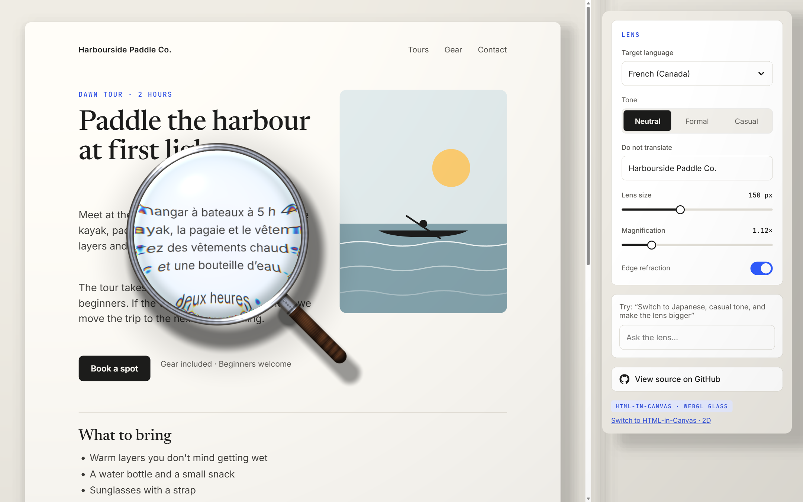

# Translation Lens

A magnifying glass you move over a web page. Under the glass, the page is translated.

**Live:** https://translation-lens-six.vercel.app



It's an experiment with three newer browser APIs:

- **HTML-in-Canvas.** The whole app (the page, the settings panel, the chat) is real DOM drawn into one WebGL canvas with `texElementSubImage2D`. The DOM is still live, so clicks, focus, scrolling and screen readers keep working. The translated page is a second drawable layer, and only the part under the lens takes clicks.
- **A WebGL glass shader.** One point light lights the scene. The lens is a domed glass that refracts with edge dispersion, Fresnel reflection and room reflections. It has a brushed-steel bezel and a varnished walnut handle, and the shadows are cast from the lamp. The page and panel are cards on a desk.
- **[UI SDK](https://ui-sdk.dev) agent bridge.** Every setting is a UI SDK control, and the chat agent reads and changes them through `snapshot`/`act`, just as a person would. Controls the agent changes light up briefly.

Translation and the agent run on **Google Gemini 2.5 Flash through [Vercel AI Gateway](https://vercel.com/docs/ai-gateway)**, from two Vercel Functions:

- `/api/translate` translates the whole page in one call. The server owns the page text: callers choose only the language, tone and a short do-not-translate list. Results are cached.
- `/api/agent` runs one model step at a time. The UI SDK tools (`snapshot`, `act`, `query`) execute in the browser, next to the live controls, and the page sends their results back for the next step.

Authentication is Vercel OIDC, so there are no provider keys. Both routes validate input, cap output tokens and are rate limited per IP.

## Browser support

- **WebGL glass scene:** needs `texElementSubImage2D`. It's available in Edge 157 and Chrome with HTML-in-Canvas; see the [explainer](https://github.com/WICG/html-in-canvas).
- **2D canvas lens:** used when only `drawElementImage` is available.
- **CSS fallback:** a `clip-path` lens that works everywhere.

The link under the panel switches between whichever renderers your browser supports.

## Develop

```sh
pnpm install
vercel link
vercel env pull .env.local   # VERCEL_OIDC_TOKEN for AI Gateway; it expires after about 12 hours, so pull again
pnpm dev                     # Vite also serves /api/* locally
```
